<a href="https://github.com/abuel3ees"><picture><source media="(prefers-color-scheme: dark)" srcset="assets/hero-dark.svg">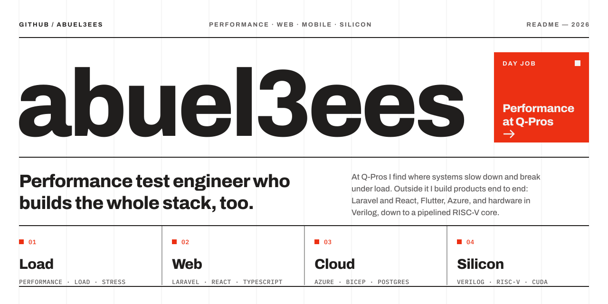</picture></a>

        

 

<picture><source media="(prefers-color-scheme: dark)" srcset="assets/range-dark.svg">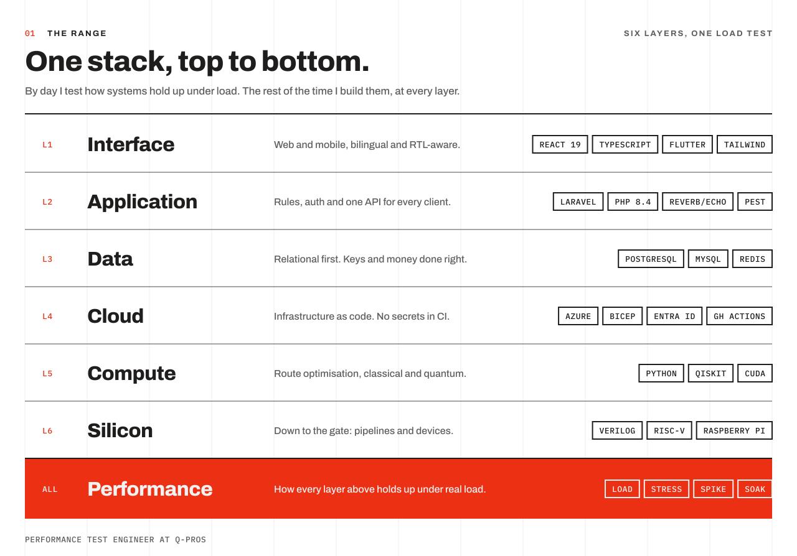</picture>

 

<picture><source media="(prefers-color-scheme: dark)" srcset="assets/work-head-dark.svg">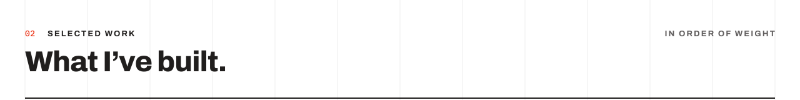</picture>

<a href="https://github.com/abuel3ees/sahl"><picture><source media="(prefers-color-scheme: dark)" srcset="assets/work-01-dark.svg">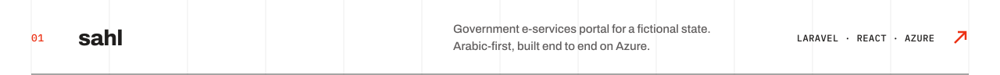</picture></a>
<a href="https://github.com/abuel3ees/Vectora-Web"><picture><source media="(prefers-color-scheme: dark)" srcset="assets/work-02-dark.svg">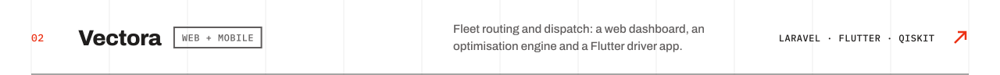</picture></a>
<a href="https://github.com/abuel3ees/rover-dash"><picture><source media="(prefers-color-scheme: dark)" srcset="assets/work-03-dark.svg">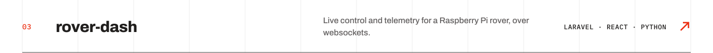</picture></a>
<a href="#jads"><picture><source media="(prefers-color-scheme: dark)" srcset="assets/work-04-dark.svg">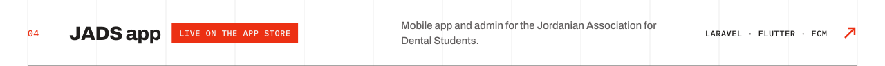</picture></a>
<picture><source media="(prefers-color-scheme: dark)" srcset="assets/work-05-dark.svg">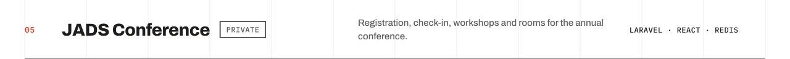</picture>
<a href="https://github.com/abuel3ees/cpu"><picture><source media="(prefers-color-scheme: dark)" srcset="assets/work-06-dark.svg">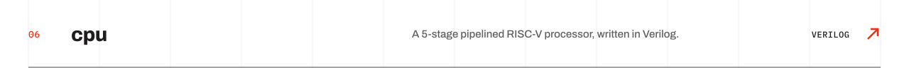</picture></a>
<a href="https://github.com/abuel3ees/GRC-APP-REACT"><picture><source media="(prefers-color-scheme: dark)" srcset="assets/work-07-dark.svg">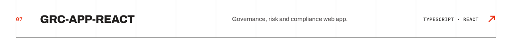</picture></a>
<a href="https://github.com/abuel3ees/Embedded-Systems-Electric-Service-Dog"><picture><source media="(prefers-color-scheme: dark)" srcset="assets/work-08-dark.svg">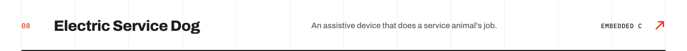</picture></a>

 

<a href="https://github.com/abuel3ees/Vectora-Web"><picture><source media="(prefers-color-scheme: dark)" srcset="assets/vectora-dark.svg">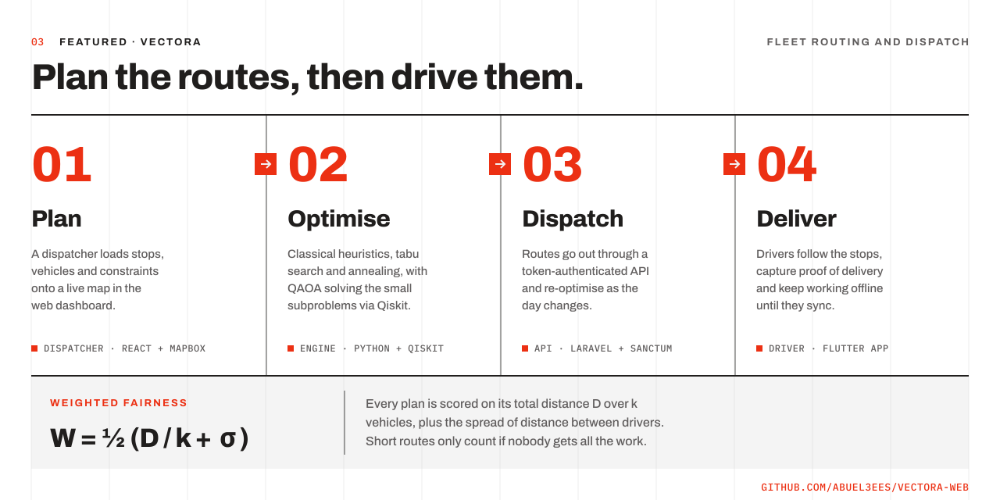</picture></a>

 

<a href="https://github.com/abuel3ees/rover-dash"><picture><source media="(prefers-color-scheme: dark)" srcset="assets/rover-dark.svg">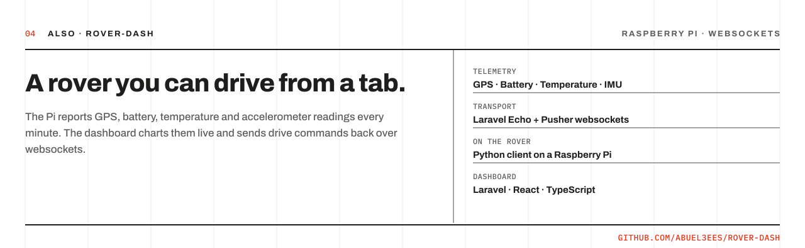</picture></a>

 

<a href="#jads"><picture><source media="(prefers-color-scheme: dark)" srcset="assets/jads-dark.svg">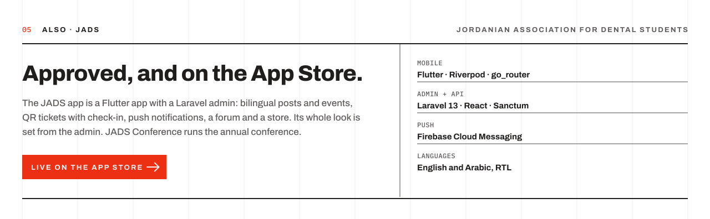</picture></a>

 

<picture><source media="(prefers-color-scheme: dark)" srcset="assets/activity-head-dark.svg">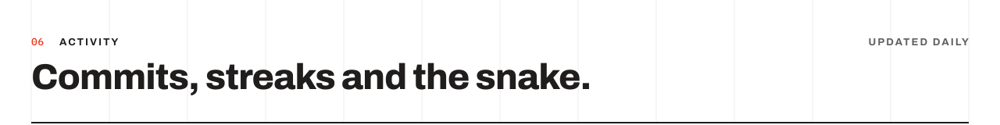</picture>

<a href="https://github.com/abuel3ees"><picture><source media="(prefers-color-scheme: dark)" srcset="https://github-readme-stats.vercel.app/api?username=abuel3ees&show_icons=true&bg_color=00000000&title_color=ec3013&icon_color=ec3013&ring_color=ec3013&hide_border=true&border_radius=0&text_color=f3f2f2"></picture></a>
<a href="https://github.com/abuel3ees"><picture><source media="(prefers-color-scheme: dark)" srcset="https://github-readme-stats.vercel.app/api/top-langs/?username=abuel3ees&layout=compact&bg_color=00000000&title_color=ec3013&icon_color=ec3013&ring_color=ec3013&hide_border=true&border_radius=0&text_color=f3f2f2"></picture></a>

<a href="https://github.com/abuel3ees"><picture><source media="(prefers-color-scheme: dark)" srcset="https://github-readme-streak-stats.herokuapp.com/?user=abuel3ees&hide_border=true&border_radius=0&background=00000000&ring=ec3013&fire=ec3013&currStreakNum=f3f2f2&sideNums=f3f2f2&currStreakLabel=ec3013&sideLabels=b5b1b0&dates=b5b1b0&stroke=5c5856"></picture></a>

<picture><source media="(prefers-color-scheme: dark)" srcset="assets/github-snake-dark.svg"></picture>

 

<picture><source media="(prefers-color-scheme: dark)" srcset="assets/now-dark.svg">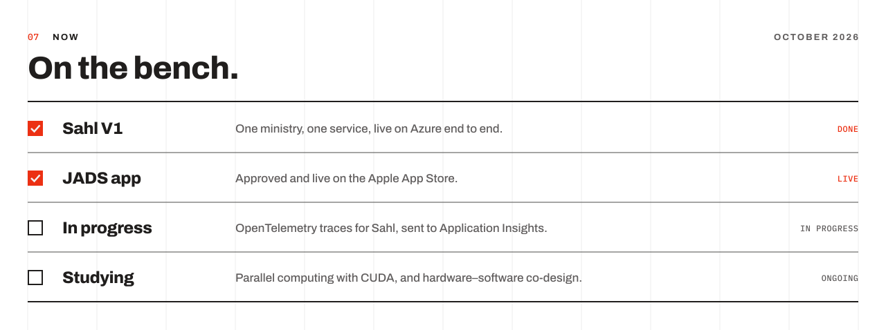</picture>

 

<a href="https://abuel3ees.dev">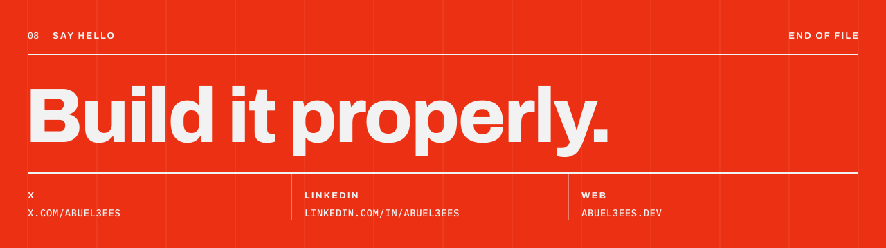</a>

<a href="https://x.com/abuel3ees"><picture><source media="(prefers-color-scheme: dark)" srcset="assets/btn-x-dark.svg">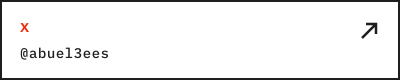</picture></a> <a href="https://linkedin.com/in/abuel3ees"><picture><source media="(prefers-color-scheme: dark)" srcset="assets/btn-linkedin-dark.svg"></picture></a> <a href="https://abuel3ees.dev"><picture><source media="(prefers-color-scheme: dark)" srcset="assets/btn-web-dark.svg">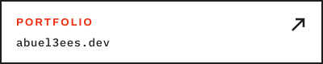</picture></a>

Set in Archivo and IBM Plex Mono. One red, <code>#ec3013</code>. 2px rules, no rounded corners: the <i>Modernist</i> system, shared with Sahl. Every banner has a light and a dark version and a transparent ground, so it sits on GitHub's own page in either theme.
